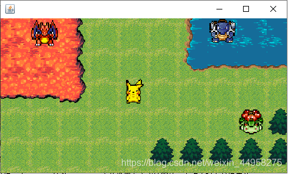
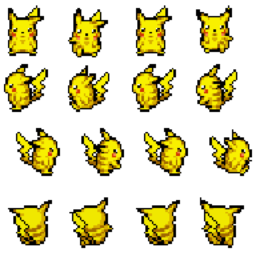
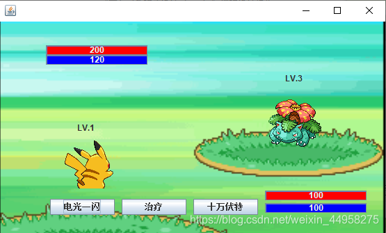
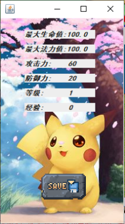

## 总体概述

游戏素材来源：[游戏素材](http://www.aigei.com/)  
java图形界面开发：[Swing教程](https://blog.csdn.net/xietansheng/article/details/72814531)  
RPG游戏人物移动等等：[RPG](https://blog.csdn.net/u013166799)  
对战界面：[回合制对战](https://blog.csdn.net/qq_21187515/article/details/90439033)

这是本人在大二暑期做的课程设计，要求基于java实现一个RPG游戏，在此做一个记录，代码里许多实现也是参考网上许多大佬分享的例子（链接在上面贴出），再做出自己的修改，有许多不足的地方欢迎大家指出。

### 英雄与NPC的创建

先写一个抽象类，是所有角色的基类：包含基本的属性，名字，血量，蓝量，攻击力，防御力，等级等等；平a，技能，升级等等方法。

```java
public abstract class Role {
	private String name;
	private double hp;
	private double maxHp;
	private double lastHp;
	private double mp;
	private double maxMp;
	private double lastMp;
	private int atk;
	private int def;
	private int lv;
	private int exp;
	private String bodypath;
	private String sName1;
	private String sName2;
	private String sName3;
	
	public abstract void attack(int skill,Role role);
	public abstract void skill1(Role role);
	public abstract void skill2();
	public abstract void skill3(Role role);
	public abstract void equipment(int i);
	public abstract void removeEqu(int i);
	public abstract void levelup();
	
	public Role(String name, double hp, double maxHp, double mp, double maxMp, int atk, int def, int lv,
			String bodypath, String sName1, String sName2, String sName3) {
		super();
		this.name = name;
		this.hp = hp;
		this.maxHp = maxHp;
		this.mp = mp;
		this.maxMp = maxMp;
		this.atk = atk;
		this.def = def;
		this.lv = lv;
		this.bodypath = bodypath;
		this.sName1 = sName1;
		this.sName2 = sName2;
		this.sName3 = sName3;
	}

	// get,set方法
	public String getName() {
		return name;
	}
	public void setName(String name) {
		this.name = name;
	}
	......
	

}
```

继承Role类，实现主角

```java
public class Hero extends Role {
	//实例化一个音效类
	Au a = new Au();

	public Hero() {
		super("皮卡丘", 100, 100, 100,100, 60, 20, 1, "src\\Image\\皮卡丘.png", "电光一闪","治疗", "十万伏特");
		this.setExp(0);
	}

	public void attack(int skill, Role role) {
		role.setLastHp(role.getHp());
		if(skill == 1) {
			skill1(role);
		}else if(skill == 2) {
			skill2();
		}else {
			skill3(role);
		}

	}

	public void skill1(Role role) {
		StartFrame.showMessage("我方使用"+this.getsName1());
		a.play(4);
		role.setLastHp(role.getHp());
		role.setHp(role.getHp()-this.getAtk()+role.getDef());

	}

	public void skill2() {
		this.setLastMp(this.getMp());
		this.setMp(this.getMp()-(0.3-0.01*this.getLv())*this.getMaxMp());
		if(this.getMp() <=0) {
			this.setMp(this.getLastMp());
			StartFrame.flag = false;
			StartFrame.showMessage("蓝量不足!");
			return;
		}else {
			StartFrame.showMessage("我方使用"+this.getsName2());
			a.play(6);
			this.setLastHp(this.getHp());
			this.setHp(this.getHp()+(this.getMaxHp()-this.getHp())*0.3);
		}

	}

	public void skill3(Role role) {
		this.setLastMp(this.getMp());
		this.setMp(this.getMp()-(0.7-0.03*this.getLv())*this.getMaxMp());
		if(this.getMp() <=0) {
			this.setMp(this.getLastMp());
			StartFrame.flag = false;
			StartFrame.showMessage("蓝量不足!");
			return;
		}else {
			StartFrame.showMessage("我方使用"+this.getsName3());
			a.play(5);
			role.setLastHp(role.getHp());
			role.setHp(role.getHp()-this.getAtk()*2+role.getDef());
		}

	}
	
	// 战斗前添加装备（老师要求有装备，(◔‸◔）所以简单的实现有些粗糙）
	public void equipment(int i) {
		if(i == 0) {
			this.setAtk(this.getAtk()+10);
		}else if(i == 1) {
			this.setDef(this.getDef()+10);
		}
	}
	
	// 战斗后卸掉装备
	public void removeEqu(int i) {
		if(i == 0) {
			this.setAtk(this.getAtk()-10);
		}else if(i == 1) {
			this.setDef(this.getDef()-10);
		}
	}
	
	// 升级
	public void levelup() {
		if((this.getExp() >= this.getLv()*(this.getLv()+1)) && (this.getLv() < 10)) {
			this.setLv(this.getLv()+1);
			this.setMaxHp(this.getMaxHp()+0.1*this.getMaxHp());
			this.setHp(this.getMaxHp());
			this.setMaxMp(this.getMaxMp()+0.05*this.getMaxMp());
			this.setMp(this.getMaxMp());
			this.setAtk(this.getAtk()+4);
			this.setDef(this.getDef()+2);
		}else {
			this.setHp(this.getMaxHp());
			this.setMp(this.getMaxMp());
		}
	}
	
}
```

其他NPC也是类似的方法，就不一个个贴了，NPC不会升级什么的，所以更简单一些。

### 图形化界面

图形化界面都是由Swing制作的，按钮，进度条等等控件都可以直接拖，还是很方便的。地图地形是本人写了一个循环一张张贴出来的，比较low，大家可以参考开头RPC连接文章中实现地图生成器来自由的实现地图。  
  


```java
public class MoveFrame extends JFrame {
	Role hero;
	private JPanel contentPane;
	NPC1 npc1 = new NPC1();
	NPC2 npc2 = new NPC2();
	NPC3 npc3 = new NPC3();
	Rectangle dragonRec = new Rectangle(0,0,100,100);
	Rectangle waterRec = new Rectangle(350,0,150,50);
	Rectangle frogRec = new Rectangle(400,150,50,50);
	Rectangle pikaRec;
	Pikachu pika;
	UpdateThread ut;
	static int map1[][] = new int[6][10];


	/**
	 * Create the frame.
	 * @throws InterruptedException 
	 * 
	 */
	public MoveFrame(Role hero) throws InterruptedException{
		this.hero = hero;
		hero.levelup();
		Pikachu.Update();
		setDefaultCloseOperation(JFrame.DISPOSE_ON_CLOSE);
		setSize(500, 300);
		setLocationRelativeTo(null);
		contentPane = new JPanel();
		contentPane.setBorder(new EmptyBorder(5, 5, 5, 5));
		setContentPane(contentPane);
		contentPane.setLayout(null);
		
		JPanel panel = new 	MyPanel();
		panel.setBounds(0, 0, 484, 261);
		contentPane.add(panel);
		panel.setLayout(null);
		
		
		
		this.setVisible(true);
		this.addKeyListener(new KeyListener() {

			@Override
			public void keyPressed(KeyEvent e) {
				// TODO 自动生成的方法存根
				if(KeyEvent.VK_UP == e.getKeyCode()) {
					Pikachu.towards = 1;
					Pikachu.up = true;
				}else if(KeyEvent.VK_DOWN == e.getKeyCode()) {
					Pikachu.towards = 2;
					Pikachu.down = true;
				}else if(KeyEvent.VK_LEFT == e.getKeyCode()) {
					Pikachu.towards = 3;
					Pikachu.left = true;
				}else if(KeyEvent.VK_RIGHT == e.getKeyCode()) {
					Pikachu.towards = 4;
					Pikachu.right = true;
				}
			}

			@Override
			public void keyReleased(KeyEvent e) {
				// TODO 自动生成的方法存根
				if(KeyEvent.VK_UP == e.getKeyCode()) {
					Pikachu.up = false;
				}else if(KeyEvent.VK_DOWN == e.getKeyCode()) {
					Pikachu.down = false;
				}else if(KeyEvent.VK_LEFT == e.getKeyCode()) {
					Pikachu.left = false;
				}else if(KeyEvent.VK_RIGHT == e.getKeyCode()) {
					Pikachu.right = false;
				}
			}

			@Override
			public void keyTyped(KeyEvent e) {
				// TODO 自动生成的方法存根
				
			}
		});
		pika = new Pikachu();
		pika.start();
		ut = new UpdateThread(panel);
		ut.start();
	}
	
	public void openStart(int i) {
		pika.interrupt();
		//ut.interrupt();
		if(i == 1) {
			StartFrame sf = new StartFrame(hero,npc1);
			sf.setVisible(true);
		}else if(i == 2) {
			StartFrame sf = new StartFrame(hero,npc2);
			sf.setVisible(true);
		}else if(i == 3) {
			StartFrame sf = new StartFrame(hero,npc3);
			sf.setVisible(true);
		}
		this.dispose();
	}
	
	public boolean collision() {
		pikaRec = new Rectangle(Pikachu.x,Pikachu.y,Pikachu.width,Pikachu.height);
		if(dragonRec.intersects(pikaRec)) {
			openStart(1);
			return true;
		}else if(waterRec.intersects(pikaRec)) {
			openStart(2);
			return true;
		}else if(frogRec.intersects(pikaRec)) {
			openStart(3);
			return true;
		}
		return false;
	}
	
	class MyPanel extends JPanel {
		// 一张张贴出地图地形
		public void paint(Graphics g) {
			super.paint(g);
			for(int i=0;i<6;i++)
				for(int j=0;j<10;j++) {
					if(i == 2&&j == 2) {
						g.drawImage(Pictures.draw(0).getImage(), 50*j, 50*i, 50, 50, null);
						g.drawImage(Pictures.draw(22).getImage(), 50*j, 50*i, 50, 50, null);
					}else if(i <= 2&&j == 2) {
						g.drawImage(Pictures.draw(0).getImage(), 50*j, 50*i, 50, 50, null);
						g.drawImage(Pictures.draw(23).getImage(), 50*j, 50*i, 50, 50, null);
					}else if(i == 2&&j <= 2) {
						g.drawImage(Pictures.draw(0).getImage(), 50*j, 50*i, 50, 50, null);
						g.drawImage(Pictures.draw(24).getImage(), 50*j, 50*i, 50, 50, null);
					}else if(i < 2&&j < 2) {
						g.drawImage(Pictures.draw(25).getImage(), 50*j, 50*i, 50, 50, null);
					}else if(i == 1&&j == 6) {
						g.drawImage(Pictures.draw(0).getImage(), 50*j, 50*i, 50, 50, null);
						g.drawImage(Pictures.draw(17).getImage(), 50*j, 50*i, 50, 50, null);
					}else if(i <= 1&&j == 6) {
						g.drawImage(Pictures.draw(0).getImage(), 50*j, 50*i, 50, 50, null);
						g.drawImage(Pictures.draw(18).getImage(), 50*j, 50*i, 50, 50, null);
					}else if(i == 1&&j >= 6) {
						g.drawImage(Pictures.draw(0).getImage(), 50*j, 50*i, 50, 50, null);
						g.drawImage(Pictures.draw(19).getImage(), 50*j, 50*i, 50, 50, null);
					}else if(i < 1&&j > 6) {
						g.drawImage(Pictures.draw(20).getImage(), 50*j, 50*i, 50, 50, null);
					}else {
						g.drawImage(Pictures.draw(0).getImage(), 50*j, 50*i, 50, 50, null);
					}
				}
			
			Pikachu.myDraw(g);
			
			for(int i=3;i<6;i++)
				for(int j=0;j<10;j++) {
					if((i == 3&&j == 9)||(i == 4&&j>=5)) {
						g.drawImage(Pictures.draw(21).getImage(), 50*j, 50*i, 50, 50, null);
						}
				}
			//绘制三个NPC的位置
			g.drawImage(Pictures.draw(1).getImage(),50,0,50,50,null);
			
			g.drawImage(Pictures.draw(2).getImage(),350,0,50,50,null);
			
			g.drawImage(Pictures.draw(3).getImage(),400,150,50,50,null);
		}

	}
	
	class UpdateThread extends Thread {
		JPanel panel;
		public UpdateThread(JPanel panel) {
			this.panel = panel;
		}
		
		@Override
		public void run() {
			while(!Thread.currentThread().isInterrupted()){
				panel.repaint();
				if(collision()) {
					break;
				}
				try {
					Thread.sleep(10);
				} catch (InterruptedException e) {
					e.printStackTrace();
				}
			}
		}

	}
}
```

移动效果可以参考开头RPG那位博主的文章，里面有实现玩家移动，地图生成器等等，地图生成器小弟当时比较菜没有实现，就跟着教程实现了移动的部分，主要先找到一张4*4的人物移动素材图，然后在循环里面根据键盘的输入切换这些图片达到移动的动画效果。  
  


### 战斗过程

  
  
战斗界面其实就是进度条表示血蓝条，三个按钮发动技能，大部分代码Swing会自动生成，只要在按钮里添加触发的事件即可，其实就是按每个按钮调用主角类相应的技能方法，NPC的攻击使用随机数实现，大家可以自行调整来更改发动每个技能的概率。

战斗界面可以学习[回合制对战](https://blog.csdn.net/qq_21187515/article/details/90439033)这篇文章，里面还有通过延时实现血条逐渐下降的效果，还是很炫酷的。

**主角攻击**

```java
// 不同的按钮调用主角类不同的技能即可
JButton btnNewButton = new JButton();
		btnNewButton.addActionListener(new ActionListener() {
			public void actionPerformed(ActionEvent arg0) {
				flag = true;
						try {
							attack_course(1);
						} catch (InterruptedException e) {
							// TODO 自动生成的 catch 块
							e.printStackTrace();
						}
			}
		});
		btnNewButton.setBounds(73, 255, 93, 23);
		btnNewButton.setText(role.getsName1());
		panel.add(btnNewButton);
		
		JButton btnNewButton_1 = new JButton();
		btnNewButton_1.addActionListener(new ActionListener() {
			public void actionPerformed(ActionEvent e) {
				flag = true;
						try {
							attack_course(2);
						} catch (InterruptedException e1) {
							// TODO 自动生成的 catch 块
							e1.printStackTrace();
						}
			}
		});
		btnNewButton_1.setBounds(176, 255, 93, 23);
		btnNewButton_1.setText(role.getsName2());
		panel.add(btnNewButton_1);
		
		JButton btnNewButton_2 = new JButton();
		btnNewButton_2.addActionListener(new ActionListener() {
			public void actionPerformed(ActionEvent e) {
				flag = true;
						try {
							attack_course(3);
						} catch (InterruptedException e1) {
							// TODO 自动生成的 catch 块
							e1.printStackTrace();
						}
			}
		});
```

**NPC攻击**

```java
	public void enemyattack(Role role,Role role2)  {
		int i;
		while(true) {
			i = (int)(Math.random()*8);
			if(i>=0&&i<=3) {
				role.skill1(role2);
				showMessage("敌方使用了"+role.getsName1());
				refreshHp(role,role2,progressBar_1,progressBar,blueBar_1,1,1000);
				break;
			}else if(i==4||i==5) {
				role.skill2();
				if(flag) {
					showMessage("敌方使用了"+role.getsName2());
					refreshHp(role,role2,progressBar_1,progressBar,blueBar_1,2,1000);
					break;
				}else {
					//System.out.println("治疗蓝量不足 重新选择");
					continue;
				}
			}else{
				role.skill3(role2);
				if(flag) {
					showMessage("敌方使用了"+role.getsName3());
					refreshHp(role,role2,progressBar_1,progressBar,blueBar_1,3,1000);
					break;
				}else {
					//System.out.println("大招蓝量不足 重新选择");
					continue;
				}
			}
		}
			
	}
```

### 结算界面

  
  
结算界面比较简单，控件拖拖拖就好了，在label里面显示相应的属性，然后存到sqlite数据库，大家也可以选择其他的数据库。

### 最后

这是一年多前写的东西了，现在看来编码习惯还有没有注释什么的看起来确实有点离谱哈哈，虽然有很多不会的地方都是借鉴大佬的，不过这次实践也是受益匪浅。为了增加游戏的趣味，我还加入了音效，以及调整游戏数值让主角和NPC战力更接近。  
总而言之，还是很好的一次提升自己的机会，如果大家发现有什么不足之处，欢迎指出。

### 代码连接

上传的有点乱，代码在 `src/RPG` 中：[sanguinedab/pokemon_mini](https://gitee.com/sanguinedab/pokemon_mini)
